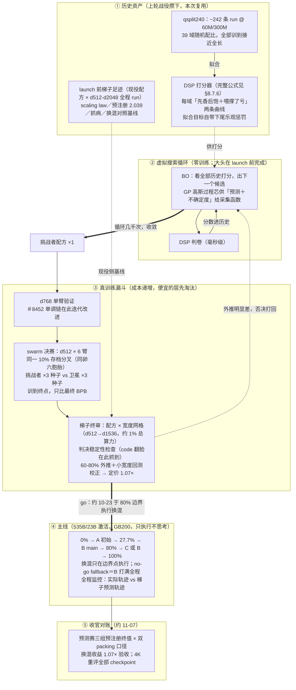

# Marin 535B Hero Run 与 Harrier 数据管线深度分析

> **项目性质**：开源工程项目（非论文）。Stanford 起源（David Hall + Percy Liang，2024 年创建），现由 Open Athena 主导（约 10 FTE），资助方含 Google TPU Research Cloud、Huang Foundation、Siegel Family Foundation 等。
> **Hero Run**：535B 总参 / 23B 激活 MoE，18T tokens（390,139 steps × 4K→16K 上下文），GB200 集群，2026-08-21 启动。**2026-10-30 状态：10-21 快照 step 302,999/390,139 = 77.7%，实际节奏 ~5.0k steps/天（全程约 79 天），收官 ETA ~11-07±2 天；seqlen 已于 ~step 252k 切 16K、phase-2（80%）推算已生效，详见 §8.6**。全部代码（GitHub marin-community/marin）、实验讨论（issue 体系）、权重（HF）、训练语料构成、逐 checkpoint 指标（W&B）公开。
> **判级**：T1 **[高价值]**——混合搜索协议栈与聚类管线均为可直接采用的方法论；数值结论不迁移（目标函数为 macro BPB，非 STEM accuracy；尺度差 4 个数量级）。

---

## 0. 一句话结论

这是目前公开可见的**最完整的"语义聚类 + 配比搜索 + 分阶段调度"端到端工程实现**：40 语义域 × 5 质量桶 = 200 单元格混合空间，BO + 多种子 swarm + 缩放梯子三层验证选权重，三阶段（initial/main/cooldown）中途换混。对用户的两条轴：**配比轴**拿走"共享前缀 + 多种子 + uncheatable held-out + 外推回测校正"的实验协议；**聚类轴**拿走"5k→40 两级聚类 + 按内容类型校准质量分桶 + 微簇基直方图特征（解决重聚类搁浅）"的管线设计。

## 1. 可信度评估

- **人员**：David Hall（EleutherAI 出身，Pythia/Marin 系）+ Percy Liang（Stanford CRFM）。embedding 模型为微软发布（harrier-oss-v1 家族，MIT 许可）。
- **历史记录**：Marin 8B 在 19 项基座评测中对 Llama 3.1 8B 赢 16 项；129B-A16B MoE 落在预注册 loss 预测 1% 以内；Delphi scaling suite（训练至 1e23 FLOPs）预测 300× 更大模型误差 0.2% 以内。
- **预注册文化**：hero run 提前注册 18T 目标 Paloma eval loss = 2.04；换混（mixture swap）先经缩放梯子验证再部署；**run 进行中即出现三方公开预测赛**（官方/bethehand/mindscanlabs NAI，预注册终值各不同，见 §8.6.2）——预测科学的现场示范，结局前锁死评分口径。
- **自我诚实声明**：issue #9126 明确写"swarm 帮助选择该混合，因此不是独立验证"；斜率跨宽度迁移、回测残差迁移等假设逐一标注。
- **无同行评审**——但可复现性高于论文标准：权重 parquet、对照 CSV、analyze.py 脚本、六个源 run 全部公开可下载。
- **可信度结论**：高于绝大多数 arXiv 论文（全程可审计）。风险不在造假，在工程结论的规模化外推（他们自己也这么标注）。

## 2. Harrier 数据管线全貌（聚类轴）

### 2.1 语料与去重
- 292 个规整化源（web 抓取 + Wiki/Ar5iv/StackExchange markdownify 产物 + 代码 + agentic 语料等，18.71B 篇文档，162,535 分片）
- 全局模糊去重 → 规范文档集合；**嵌入同时用于模糊去重**（一鱼两吃，issue #8162）
- **实际源构成（从簇总览页源富集信息提取，2026-09-15 补）**：以 **Nemotron 生态为主**——nemotron_cc_v2 / v2_1（按质量分档的 Common Crawl：high/medium/medium_high + synthetic + diverse_qa + translated 变体，占绝对主导）、nemotron_code_v1/v2（content + synthetic_code_review/synthetic_question_answering）、**nemotron_cc_math_v1**（含 4plus_mind 档——与 UltraData 分析中 Nemotron-CC 4plus 同族）、nemotron_specialized（stem_sft、rqa）、nemotron_sft/sft_math；多语言：hplt_v3、common_corpus (Pleias)、finetranslations、finepdfs（法/德/西/俄/意/葡/日）、dolma4pdfs、**climblab-ja**（ClimbLab 日语版！与用户基座同源语料的直接亲缘）；代码补充：stack-v3、eai-taxonomy-code-w-dclm、swe-rebench/swe-zero；专门源：cp/uspto（专利）、edgar（SEC 文件）、institutional_books。**要点：Marin 的"自有语料"大量复用 NVIDIA 公开语料家族（含 ClimbLab 系），自产部分主要是 agentic transcripts 与再处理管线**

### 2.2 嵌入
- 模型：`microsoft/harrier-oss-v1-0.6b`（多语言，0.6B 参数，1024 维，32k 上下文，MTEB v2 多语言 69.0；家族含 270m/0.6b/27b 三档，270m 与 0.6b 用大模型蒸馏）
- 处理：截断 100k 字符 / 8,192 tokens → L2 归一 → int8 量化（±0.3 范围）；抽样 9,733 行验证平均 cosine 0.99976、坐标裁剪率 0.00012%
- 工程：128 卡 H100 TEI 服务池，CPU worker 并发 8 文档请求

### 2.3 两级聚类（关键设计）
1. **微簇层**：5,000 质心球面 k-means，训练样本 10M 文档、跨全部 292 源均衡采样（≤1k 文档的源给 1 文档下限）
2. **域层**：按全样本分配加权 → 多种子加权分裂式球面聚类 + 精确单质心爬山法粗化 → **40 个语义域**
3. **约束**：每域强制 ≥1% 人口（防退化微簇）

40 域标签示例（人工检视命名，非自动）：Geopolitics/WorldNews、ConsumerHealth、Arts/History/Culture、Finance/Insurance、Command-Line Agent Transcripts、SW Dev/WebCode、PerfLogs/LowLevelCode、NaturalSciencesResearch、SWInfra/Security、Law/Courts、History/Literature、Math Problems/Proofs 等。

### 2.4 质量轴（正交于聚类轴）
- 融合分数模型（`datakit/models/quality/nemotron_88k`）产出原始分数
- 内容类型分类器：agentic / code / math / multilingual / prose / structured / default
- **按内容类型校准的分位截断**（同一分数阈值对代码/数学/散文含义不同）→ Q0-Q4 五桶。截断例（Q1/Q2 边界）：prose 0.430、default 0.460、agentic 0.477、multilingual 0.498、code 0.564；Q3/Q4 边界：multilingual 0.699、code 0.747、math 0.788、prose 0.780
- 产出：每文档 `content_type, raw_score, score, quality_bucket`

### 2.5 结果
23.11T tokens 分布于 **200 单元格（40 域 × 5 质量桶）**，存为 `store_4d2e363d`。配套簇总览页：每簇示例文档 + 源富集度 + 可解码训练文本逐条检视（可审计性设计）。

## 3. 混合权重选择（配比轴）

### 3.1 权重表示
混合 = 200 维单纯形上的权重向量（域 × 质量联合单元格），按训练阶段切换。

### 3.2 三层选择机制
1. **initial 阶段（0-27.7%，step 108,000 前）**：贝叶斯优化产出（run 名 `harrier-bo-20260817-monotonic-regret-quality-technical-d768-seed0`，"quality_technical" 候选，d768 梯子选出）
2. **main + cooldown 阶段**：**d512 mixture-search swarm**（`h100-d512-from10pct-store-4d2e363d`）——**共享前缀协议**：六个 run（新混 3 种子 + 旧混 3 种子）全部从同一 step-393 checkpoint（10% 基线训练后）恢复，各自在候选混合下训练剩余预算至终点，比较**最终** BPB（非代理预测）
3. **单调性提升链**（issue #8452）：用 d768 梯子比较"epsilon0 单调 PI 候选"vs 原 PI 候选——step 1712 处 dropless 聚合 BPB 1.05726→1.05059、uncheatable BPB 0.93675→0.92418；候选保持 store 与相位预算不变，**最大模拟桶曝光 2.96 epochs**（重复度硬上限）

### 3.3 换混的事前验证（issue #9126，方法论上最完整的一段）
- **缩放梯子**：d512/d768/d1024/d1536 全程训练，旧混 vs 新混对照
- **预测方法**：对 d1536 的 60%/65%/70%/75%/80% 检查点 loss 线性拟合外推至 100%，再用两个已完成小宽度（d768/d1024）同窗口回测残差的均值（+0.00941 loss / +0.00375 BPB）校正
- **结果**：d1536 调整后预测 final macro loss 2.55421 / BPB 0.92256 vs 旧混基线 2.56377 / 0.92507 → **1.07× 等算力加速**（原始外推 1.18×，校正后保守化）
- **swarm 实测**：macro Paloma −0.62%、uncheatable −1.43%（C++ −5.11%、Python −2.09%、arXiv physics −2.96%）；但梯子 d768/d1024 上 macro 仅 +0.41%/+0.70% 且 **code BPB 回归**——宽度间不一致性如实呈现
- **等算力换算**：speedup = (old BPB / new BPB)^(1/α)，按子集幂律斜率，macro α=0.040007

### 3.4 评测体系
- Paloma（Stanford 靶向子集 benchmark，16 子集）为主指标，BPB（bits per byte）计量
- **7 个 uncheatable held-out 数据集**：作为零权重验证组件嵌入每个梯子 rung——训练数据中严格零曝光，防指标污染
- **多长度评估系列（#10711，2026-10-26 补）**：4K / 当前训练长度 / 65K / 262K 各自独立 metric 系列，评估上下文高于训练长度时延迟——起因是打包口径切换本身制造 ~0.03 系统差、262K 打包静默剔除短子集（见 §8.6.3/§8.6.4）
- 主观观察：这套"训练内零权重 held-out"设计对 accuracy 评测同样适用（用户 nanochat 直评 accuracy 场景）

## 4. 三阶段调度的数值（2026-10-30 状态：phase-1 全部已跑完；phase-2 边界=80% 即 step ~312k，按 ~10-23 前后推算已实际生效——梯子每个 rung 在 80% 处都有可见的小 loss bump 为佐证；权重数值源自 PR #9162 计划）

| 维度 | initial (0-27.7%) | main (27.7-80%) | cooldown (80-100%) |
|---|---|---|---|
| 最大簇 | SW infra/security 9.3% | PerfLogs/低层代码 10.6% | PerfLogs/低层代码 11.4% |
| 自然科学研究 | 8.8% | 6.9% | **11.3%** |
| Agent transcripts | 1.3% | 6.0% | 6.6% |
| 通用 SW dev/web code | 7.9% | 4.5% | 3.1% |
| 数学问题与证明 | 4.3% | 1.8% | **1.4%** |
| 历史/文学 | 6.9% | 3.7% | 3.7% |
| 金融 | 5.6% | 2.4% | 2.8% |
| 法律 | 1.1% | 3.6% | 2.9% |
| 世界新闻 | 0.8% | 2.7% | 1.8% |
| **Q4（最高质量桶）** | **22.6%** | **22.9%** | **28.0%** |

三个可读出的模式：
1. **冷却期升质量桶**（Q4 22.9→28.0%）——annealing-on-quality 的又一工业佐证（与本项目一线大厂 annealing 分析一致）
2. **agentic 数据为一级公民**：Command-Line Agent Transcripts 是独立语义簇且权重全程上升（2026 预训练新常态的信号）
3. **math 簇权重全程下降**（4.3→1.4%）——⚠️ 目标函数是 macro Paloma BPB（数学簇占比小、科学研究文档对 BPB 边际收益更高），**不能读作"数学数据不重要"**；与用户 STEM accuracy 目标是两个目标函数，此数值不构成对 r=0.7 的任何方向性证据

## 5. 方法论核心：桶无关代理（mixing_via_embeddings 设计，issue #6969）

**问题**：他们的混合代理模型（DSP/GRP/LightGBM，拟合于 ~242-run 的 qsplit240 swarm）以**桶索引权重向量**为输入——任何桶重定义（质量重标 #6739、域重聚类 #6491、新数据源）都搁浅整个扫描，被迫近乎全长度重跑代理（因为**早期检查点排序不稳定：60M 模型在 22% 进度处 Spearman 仅 0.298**——又一个 proxy 不可靠的独立证据，与本项目 Proxy Reliability 结论一致）。

**方案**：把混合重新特征化为**冻结微簇基上的 token 加权直方图 h = V·w**（V = 单元格×桶组成矩阵）→ 代理 g(h)→指标 对任何可嵌入的桶有定义；新增/重定义桶只需一次 map-only 嵌入作业，不再重扫。

**文献定位（他们自己的）**：Domain2Vec（arXiv:2506.10952）是存在性证明（meta-domain 直方图回归 + 免重拟合适应新数据，但仅 ≤1B + 260 格粗分类法）；**CLIMB（arXiv:2504.13161，即用户基座 ClimbLab/ClimbMix 来源）被点名为反面教材**——"嵌入派生簇但位置性预测器，重聚类即重触发其 112-run 扫描——正是我们当前的陷阱"。

**验证设计（值得照抄的严谨度）**：
- 全部追溯式（retrodictive）于已有 swarm run，**零新代理训练**验证前提
- H1 信息审计 / H2a 内容→域价值 LODO 门 / H2b held-out-dose 追溯（只在域 k 曝光≈0 的 run 上训练、预测域 k 主导的 run；全程完整特征化，禁用 column-drop 变体）
- **语义 V vs 匹配的非语义再参数化对照**（逐列单元格置换、打乱的域↔列映射）——识别"#6326 线性重参数化陷阱"：固定桶集上直方图是权重的固定线性映射，拟合打平是预期的、无信息量的；外推成功与否全部由内容空间上的平滑先验承载
- 强制无簇基线臂（RFF/MMD 核方法）+ 预承诺双基 kill 规则

**跨 swarm 迁移 GP**（issue #8633）：在全部已注册混合 swarm 上拟合共享内容响应的 GP——phase-linked Matérn 协协方差共享内容响应 + 同 swarm 残差项；先验均值学习**相位特定的平方模拟 epochs 惩罚**（重复度的软约束进先验）；MC noisy expected improvement 选两点相位混合；两相位单纯形离散在 1/49,152 格点。无 BoTorch/Ax 依赖，纯 JAX。

## 6. 多轴标注路线图（issue #8453，规划中未完成）

引用 MATES / Group-MATES / RegMix / RegMix-D / Meta-rater / DataMan / DoGE / Spokes / propella-1，主张：
- 质量从标量 → 多维标签向量（DataMan 14 准则、Meta-rater 4 维、propella-1 18 属性）
- 摆脱 LLM-oracle：下游性能、梯度对齐、**随训练状态变化的动态标签**（MATES 式 step-t 条件 loss）
- 组级效用（Group-MATES：文档影响分数不可独立看待；Spokes：多样性是集合级属性，桶本身也应有标签）
- 终态：**每文档一个标签向量 → 在（标签 × 域）上聚类成桶 → swarm 在桶上搜索**

与本项目 Group-MATES 深读结论同向；注意这是 roadmap 而非已实施——hero run 用的仍是 5 轴质量 + 40 域。

## 7. 与 CLIMB/ClimbMix 的对照（用户复现轴）

| 维度 | CLIMB / ClimbLab（用户基座） | Marin Harrier |
|---|---|---|
| 嵌入 | sentence embedding + K-means | harrier-oss-v1-0.6b（1024d，int8 量化） |
| 聚类层级 | 20 个扁平簇 | 5,000 微簇 → 40 域两级 |
| 质量轴 | 无独立正交维度 | 5 桶 × 按内容类型校准截断（正交） |
| 退化防护 | — | 源均衡采样下限 + 每域 ≥1% 人口 |
| 权重搜索 | 112-run 代理扫描（位置性预测器） | BO（单调 regret）+ 共享前缀多种子 swarm + 缩放梯子验证 |
| 重聚类稳健性 | 重聚类即重扫（被 Marin 点名） | 冻结微簇基直方图特征（宣称新增桶只花一次嵌入作业） |
| 重复度控制 | dedup 后 ~单 epoch | 桶级模拟曝光上限（2.96 epochs） |
| 评测 | 下游 accuracy 基准 | Paloma BPB + 7 个零权重 uncheatable held-out |
| 中途换混 | — | 三阶段调度 + 事前梯子验证 + 外推回测校正 |

**复现启示（可操作清单）**：
1. **若复现中要改簇数/质量定义**：先冻结一个微簇基（如 5k 质心），把混合表示成基上的直方图——已积累的 proxy/surrogate 结论可跨桶定义保留（这是对 CLIMB 位置性预测器缺陷的直接修复）
2. **小源下限 + 最小人口约束**：防长尾源和退化簇污染聚类
3. **质量分数按内容类型分别校准截断**：用户 STEM 池内代码/数学/散文应各有分位线
4. **混合搜索协议**：共享基座 checkpoint 恢复 + 多种子 + 训练至终点比 final 指标（避开早期检查点排序不稳定问题）

## 8. 对用户场景（1.5B / 1.8B tokens / STEM accuracy）的适用性边界

**不迁移**：
- 全部数值（40 簇构成、三阶段权重、Q4 占比）——语料、目标函数、尺度全不同
- **BPB/macro-loss 目标 vs STEM accuracy 涌现**：与 #68 LogFloor 教训同构（loss 排序 ≠ accuracy 排序），Marin 全程优化 loss，未触碰 accuracy 涌现问题；他们的协议不解决本项目"核心未解决问题"
- 535B/18T 与 1.5B/1.8B 差约 4 个数量级；其"早期检查点不可靠"结论反而在更小尺度更严重

**可迁移（方法论协议，判 [高价值] 的依据）**：
1. **r 扫描实验设计**：共享基座 checkpoint 恢复 + 每配置多种子 + held-out uncheatable 评测——直接套用于 r=0.7 对照组扩展与 400M proxy 线（对 N=1-2 预算：至少保住"共享前缀"与"held-out 零曝光"两点）
2. **冷却期升质量**：Q4 22.9→28% 佐证 annealing 高质量结论（一线大厂分析的第三个独立来源）
3. **桶级 epoch 上限意识**（2.96 epochs cap）：用户 1.8B tokens 中 STEM 子池的有效重复度应显式核算
4. **外推 + 回测校正的中期预测**：60-80% 检查点线性外推 + 更小尺度残差校正——N=1-2 预算下中途决策（是否终止/加种子）的省钱工具
5. **agentic 簇的存在感**：未来 STEM 池扩展的候选维度（暂不行动）
6. **"STEM 重仓"的三根独立轴（2026-09-15 用户指定记录）**：Marin 把加码 STEM 拆成三根可独立调节的轴——**① 内容簇**（science/code/math 各自调权重）、**② 质量档**（收尾把 Q4 从 23%→28%）、**③ 时机**（三阶段切换，硬核/高质量后置）——且三根轴各自经过验证（swarm 对照赛/梯子）。用户当前 r=0.7 只动了第一根；**将来 r 定论后若想继续榨收益，后两根（质量档课程 + 时机课程）是现成的、已被工业验证的方向**（与 #101 tiered vs mix +1.49pp、#84 Puro 质量课程同族互证）

**存档不行动**：math 簇全程降权（4.3→1.4%）——目标函数不同，不构成对 r=0.7 的反证。

## 8.5 讨论沉淀（2026-09-15 问答补充，深挖 research.md 后新增）

### 8.5.1 代理模型实测排名：参数化结构 > 黑盒（对用户代理线的直接证据）

从 #6969 设计文档的 research.md 翻出的硬数据（qsplit240 swarm：约 240-242 个 proxy run，60M 与 300M 两档宽度，39 个手定义域，Dirichlet+顶点偏置采样权重）：

- **LightGBM（literal RegMix）= 弱基线**，留着当对照
- **生产代理是 DSP**：手写结构参数化模型（benefit/饱和/penalty 三段式 + epoch/exposure 特征），uncheatable BPB 上 OOF Spearman **0.914**
- **反例（#6326）**：MDE 式 900 列特征工程只有 **0.86**——那些特征本质是权重的重参数化（有效秩 ≈22 ≈ 混合几何本身），**加列不加信息**
- **60M→300M identity transfer Spearman 仅 0.777**（swarm-transfer-calibration.md）——proxy 跨尺度名次不可靠的**第三个独立来源**（前两个：Proxy Reliability #10、Marin 60M@22% 进度 0.298）；用户"400M 结论上 1.5B 前须中间验证点"规矩再加一票
- **GP 不在"预测更准"赛道**（qsplit240 的生产预测器里没有它），它只在两个必须不确定性的地方出现：BO 采集（初始配比选择）与跨 campaign 迁移（#8633）；注意标准核的 GP 同样是平滑的，**不解决相变形状问题**

**启发**：数据少（~240）噪声大时，把理论结构（饱和/惩罚）手工写进公式打赢自由度大的黑盒——与本项目 InfoLaw/#27/#05 参数化定律流派同向；RegMix 的 LightGBM 代理失败多了一层解释（树模型在少样本噪声场景+外推任务上天生吃亏）。

### 8.5.2 形状问题：平滑饱和公式 vs 相变（为什么 Marin 的公式族不能搬到用户目标上）

- DSP 一族的形状 = "一直缓慢上升、任何点都有点收益"；相变（#01）的真实形状 = "阈值以下收益为零、过阈后跳变"。**常数调不出形状**——这是 misspecification，数据只能修常数错、修不了形状错
- 对用户的实际含义：**形状错误只在"跨阈值/跨 regime"时致命**。1.5B 知识获取阈值 r_thres≈0.06-0.08，r=0.7 在"远超阈值"区，该区域真实曲线局部平滑，饱和形状局部够用——**r=0.7 附近的局部问题不受此威胁**；危险区仅两处：① 400M proxy（自身阈值更高、可能在阈值附近，看到的曲线形状与 1.5B 真的不同——这是 proxy 不可靠的形状学解释）② 任何探小 r 的实验
- 对策四条：① 跨尺度只带锚点不带公式（400M 缩小候选清单，1.5B 锚点定夺——既有规矩）② 若必须建模相变，用 hinge/分段形状并把 r_thres 当待拟合参数（#01 本来就是这个形状，项目手里握着正确公式族）③ 找阈值用二分式加密采样而非均匀网格 ④ 残差照妖镜：拟合完把残差对 r 画图，系统性弯曲 = 阈值未捕捉，换分段

### 8.5.3 N=1-2 防自欺三件套（同族规则：把"规则"和"数据"分开时刻）

1. **预注册**：开跑前锁死主指标/判定阈值/预期数字——堵死后挑指标和移动球门；预期错了不丢人（校准自己），锁的是规则不是未来
2. **赢者诅咒**：从带噪声的一批数字里挑最大值，挑中的幅度系统性虚高（候选越多、种子越少越狠）——400M 横向对比用于**决定**（选谁上 1.5B）合法，其领先幅度用于**证据**（"这配比能带来多少收益"）非法；干净证据 = 1.5B 新跑的、从未参与选拔的对比
3. **独立性标注**：报告时回答"这组分数是否参与过选择过程"——选拔用过的评测既当裁判又当选手时，其数字只可用于决策不可用于验证

### 8.5.4 三道门分解（沉淀进 `核心未解决问题_相变与代理迁移.md` §1.3）

门1【数据轴】知识获取阈值 r_thres（1.5B≈0.06-0.08，r=0.7 远过）/ 门2【训练量轴】走完相变所需 tokens（r<0.4 超指数长，r=0.7 便宜，但 1.8B 预算是否走完无法先验计算）/ 门3【能力轴】benchmark 分数起跳点（知识装入≠会做题；位置未知=核心未解决问题本体）。r=0.7 只解决门1；门2/3 只能测，且**起跳时机本身是最值钱的实验产出之一**（回答"1.8B 预算买到没有"）。

### 8.5.5 缩放梯子的四个实战结论（2026-09-15 用户指定记录）

1. **梯子用 ~1% 成本抓到过致命训练病**：梯度范数随 token horizon 拉长而增长（至 4+），追溯后用 **logit z loss** 修复；事后消融证明不修则大 batch run **中途彻底爆炸**。没有梯子彩排，535B 主 run 会在训练中期死掉重来。→ 用户版：正式 1.5B run 前的 shakeout run 同理（抓数据管线/数值病）。
2. **配比收益跨宽度不稳定——rank non-invariance 的配比版实证**：swarm 在 d512（选拔宽度）上新配比 code 子集 −3.63% 大赢；梯子爬到 d768/d1024（接近部署宽度）一量，code 子集**由赢变输**，macro 也从 −0.62% 缩水到 +0.41%/+0.70%。**单宽度选拔的配比，其子集符号可在部署宽度翻转**。→ 用户版：400M 选出的配比，对具体 benchmark 的方向可能在 1.5B 反转——决赛必须在部署尺度做（与 #73 MAI rank non-invariance 互证，这是开源工程里的独立复现）。
3. **外推+回测校正的预测机器实测可信**：60-80% 检查点线性外推 + 小宽度回测残差校正，129B 预注册命中 1% 以内（Delphi 套件外推 300× 更大模型误差 0.2%）。→ 用户版：go/no-go 判定可放心采用此机器（§8 第 4 条的实证背书）。
4. **梯子是方案闸门**：外推预期明显差于上一代配方 → 打回重设计，省下 100 天大 run。梯子最贵的用途不是"确认能跑"而是**提前否决**。

## 8.6 盯哨更新（2026-10-30，hero run 后 20% 冲刺期）

### 8.6.1 时间线与进度

- **进度**：10-21 快照 step 302,999/390,139 = **77.7%（~14T/18T）**；实际节奏 ~5.0k steps/天（8-21→10-21 共 61 天），全程约 79 天，收官 ETA **~11-07±2 天**
- **seqlen 4K→16K 切换已落地**（~step 252k ≈ 64.6%，`qk_mult` 1.48）——原计划"4K→8K@50%，8K→65K@95%，尾部 262K"改为直上 16K；训练打包长度的切换连带评估打包口径切换（§8.6.3 的根源）
- **phase-2（cooldown 换混，80% 边界即 step ~312k）推算已于 ~10-23 前后生效**（推算非实证：GitHub 懒加载折叠了 10 月上旬评论）；旁证：换混设计时梯子每个 rung 在 80% 处都有可见的小 loss bump
- issue #8435 于 10-21 移入 Marin high-level 项目 **Long-lived**（冲刺期转长驻跟踪）
- 花絮：d2048 梯子 rung 曾在 81% 处失败，团队选择**不恢复**、用前 81% 干净外推剩余 19%——梯子价值在方向与闸门、不在把每个 rung 跑完（与 §8.5.5 第 4 条同向）

### 8.6.2 预注册预测赛扩至三组（对答案窗口 ~11-07）

| 预测方 | 时间 | 终值预测 | 构成 |
|---|---|---|---|
| Marin 官方 | 8-19 | 2.039 | 梯子幂律拟合外推（4K 打包；显式声明是"全程 4K+同混"的假想情景，实际 seqlen/混均中途变） |
| bethehand | （issue #9977） | 2.035 [2.023, 2.047] | 同族幂律方法独立实现（4K 口径） |
| mindscanlabs | 10-21 | **A=1.979 [1.965,1.994]**；**B=1.935 [1.915,1.963]** | NAI 符号回归，**不给形式**（无 floor、无 power-law 假设）：A=梯子+hero 16K evals 锚定；B=纯梯子行 |

- **B 比官方低 0.10 的来源不是数据差，是形式假设差**：双方用同一张梯子表，官方拟合预设 floor（下限），NAI 的搜索空间不含——"外推的渐近线怎么设"这一行手工假设制造了 0.10 分歧（§8.5.1/§8.5.2 形状问题的现场版：形状假设 > 数据数量）
- 三组全部结局前锁死（NAI 另把修正评分方案于 10-25 结局前固化入库）——预注册文化的完整形态：预测、评分规则、修正规则都在看牌前定

### 8.6.3 packing 口径：同一权重换尺子量出 ~0.03 系统差

- bethehand 10-22 实测：同一 checkpoint（step 252k）**16K 评估比 4K 低 ~0.031**（`qk16k-a1-step252k` 臂 2.0929/2.0926 vs hero 4K 评估 2.1234；`qk_mult` 留 1.3 则 ~0.028；剔除 WikiText 偶然值后 0.032）
- 后果：**4K 期做的预测（官方 2.039 / bethehand 2.035 / NAI B 1.935）对 16K 终值天然虚高 ~0.03**——"预测对错"里 0.03 是尺子差、不是方法差；且偏差可能随 16K 训练继续漂移
- 处理（教科书级）：① mindscanlabs 10-25 结局前固化修正评分方案——按注册原文计分 + 并排报告 packing 修正版（4K-built 预测对 Y+Δ；Δ 取终 checkpoint 的 4K 重评值，缺则用 0.0306/0.0283 敏感性检查）；② Marin（dlwh）承诺跑完按 4K 重评**全部** checkpoint 供旧预测对账
- **对用户启示**：评估口径（打包长度 / token 化 / 子集剔除规则）本身可制造 0.03~0.06 级假差异——**大于很多真实方法差异**。中途改口径的 run 必须：双口径发布 + 结局前锁死换算规则；7-8B 验证实验若任何中途评测配置变更，照此办理

### 8.6.4 262K 扩展的评测静默失败（真 bug，10-26 已修）

- 陷阱：PTB / WikiText-103 验证集各**短于单条 262,144-token 序列** → 零 token tag → loss 记 0.0 → Paloma 组均值**静默剔除它们、变 14 子集均值**（假跳 +0.06 ≈ 3%，足以触发 eval_regressed 假警报）；顶层 macro_loss 反向把 0 平均进去（假降 −0.14）。67B 的 65K→262K 切换实测双证：`eval/paloma/macro_loss` 2.1774→2.2150 而其余 14 子集仅 +0.0004
- 修复（**#10711**，dlwh 10-26，不触活 run）：零 token tag 从顶层 loss/BPB 宏剔除；评估上下文高于当前训练长度时延迟；4K/16K/65K/262K **多长度评估系列**（各自独立 metric）；CPU 套件 3,297→**3,574 测试过**
- **对用户启示**：评测基础设施的失败模式是"**静默降级**"而非报错——任何"指标突然变好"先查评测配置是否变了（与 #68 LogFloor、早期检查点排序不稳定同族教训；nanochat 直评链路同理，val 集预处理/打包/子集变更都属此类）

## 8.7 整体流程架构与问答沉淀（2026-11-03 深挖，一图流）

### 8.7.1 全流程架构图（从历史资产到收官对账）



文字版（终端查看用，内容同上）：

```
━━━━━━ 历史资产（上一场战役攒下，本次复用）━━━━━━
  qsplit240：~242 条 run @ 60M/300M，39 域随机配比
  （每条都训到接近全长——中途排名≈噪声 0.298@22%）
        │ 拟合
        ▼
  DSP 打分器（真实公式见 §8.7.6）：每域"先香后饱＋喂撑了亏"
    预测BPB = 基线 − Σ b_d·(1−e^(−ρ_d·曝光))
                  ＋ Σ p_d·[softplus(log曝光−τ_d)]²
    每域 4 参数（ρ 饱和率/τ 惩罚阈值/b 收益价/p 惩罚价）
    ＋全局 γ 阶段折扣/λ 遗忘/r1 重复半径
    拟合目标自带"下尾乐观惩罚"（防 winner's curse）
  ＋ launch 前梯子足迹：现役配方 × d512-d2048 各宽度全程 run
    （→ scaling law、预注册 2.039、抓病、换混对照的现役侧基线）
━━━━━━ 虚拟搜索循环（零训练；大头在 launch 前完成）━━━━━━
  ┌→ BO：看全部历史打分，出下一个候选
  │    （GP 芯供"预测＋不确定度"给采集函数算探索vs利用；
  │      #8633 明确用 GP：MC noisy EI）
  │      ↓
  │  DSP 判卷（毫秒级）→ 分数进历史
  └── 循环几千次 → 收敛出 1 个挑战者配方
━━━━━━ 真训练漏斗（成本递增，便宜的层负责淘汰）━━━━━━
 ② d768 单臂验证（单臂、少量；#8452 单调链在此层迭代改进）
 ③ swarm 决赛：d512 × 6 臂，从同一 10% 存档分叉（同卵六胞胎）
    挑战者×3种子 vs 卫冕×3种子 → 训到终点，只比最终 BPB
 ④ 梯子终审：配方 × 宽度网格（d512→d1536 全程微缩，~1% 总算力）
    a. 判决稳定性：d512 冠军在更大宽度还赢吗
       （code 子集 d512 −3.6% → d768/d1024 翻输，实证翻脸）
    b. 60-80% 检查点外推＋小宽度回测校正 → hero 尺度收益定价
    外推明显差 → 否决打回（闸门）；证据混合 → 权衡后 go
━━━━━━ 主线（535B/23B 激活，GB200，只执行不思考）━━━━━━
 0% ────── 27.7% ────────── 80% ───────── 100%
 [ A 初始 ][  B main  ][ C 或 B：cooldown ]
 换混只在边界点执行；no-go 的 fallback＝B 打满全程（零成本）
 全程监控：实际轨迹 vs 梯子预测轨迹（偏离报警）
━━━━━━ 收官对账（~11-07）━━━━━━
 预测赛（三组预注册终值 × 双 packing 口径）
 换混收益 1.07× 验收 ＋ 4K 重评全部 checkpoint
```

实际时间线（与逻辑顺序不同步）：8-17 BO/d768 验证 → 8-18 剧本定稿（三阶段权重 json）→ 8-21 主线开跑 → 9-12 梯子终审落锤（1.07×，go）→ ~10-23 80% 边界执行换混 → ~11-07 收官。**配方搜索大头在 launch 前完成；开跑后支线只做终审验证＋轨迹监控**（结构性能力允许 mid-run 更新配方，但这次没这么玩——中途改剧本破坏外推可比性）。

### 8.7.2 两个正交实验轴

- **swarm ＝ 固定宽度（d512）扫配方 → 选拔；梯子 ＝ 固定配方扫宽度 → 验证**。配比的最终裁决在"配方 × 宽度"网格的交叉验证里
- 梯子顶格 rung（~1.2B 激活）距 hero（23B 激活）~19× 外推缺口——预测赛 A/B 分歧（1.979 vs 1.935）的来源

### 8.7.3 代理的边界与保鲜（FAQ 沉淀）

- **代理是提名机器不是裁决机器**：部署尺度的裁决从不交给代理；60M→300M identity transfer 0.777 是实测衰减——正因量过，才设此规矩（QuaDMix 的失败恰是违反此规矩的对照案例）
- **打分依据**：历史战役的 (配方， 实测成绩) 对拟合出的映射；每次打分的输入＝候选配方本身。"零训练"指打分那一刻，不是代理的一生
- **两条保鲜路线**（应对"60M 拟合的曲线不适用更大模型"）：① DSP 重拟合＝形状抄旧战役、常数新宽度重定（结构参数少 → 少量新 run 即可）；② #8633 分层 GP＝内容响应跨战役共享 ＋ 各战役残差项各自记账（核按训练相位挂钩、先验均值内置平方 epochs 惩罚）
- **GP 的实际位置**：不在成绩预测赛道（qsplit240 生产预测器是 DSP）；只出现在两个必须不确定性的地方——BO 采集（导航：下一个候选从哪出）与跨战役迁移（知识搬运）
- **DSP 公式（2026-11-03 源码级核验，真实形式见 §8.7.6）**：全名 reduced-bias Domain Saturation-Penalty；每域四参数（收益幅度/惩罚幅度/饱和率/惩罚阈值）＋相位 γ＋遗忘 λ＋重复半径 r1；OOF 0.914。基础版无宽度变量（每档宽度单独拟合），宽度处理与 size×mixture 交互的显式建模（amp_b(N)/amp_p(N) 振幅）见 §8.7.6
- **大小×格子交互是真实的、且会翻符号**（code 跨宽度翻脸、0.777、本项目文献 r_thres ∝ M^-1.283 同族）——代理刻画不了这个交互，梯子终审存在的原因

### 8.7.4 主线/支线与换混决策（FAQ 沉淀）

- 结构一句话：**剧本先行 ＋ 并行彩排确认 ＋ 固定边界执行**——不是实时寻优；中途乱切配方破坏所有外推与对照的可比性
- **换混是优化项非必需品**：no-go 的 fallback＝现役配方打满全程，零成本；剧本带验证条款（dlwh：datamix 原则上可 mid-run 更新，但这次没这么玩）
- **定价**＝事前把换混收益量化成可验收数字：d1536 上新旧配方各自外推到终点＋回测校正 → 新 2.55421 vs 旧 2.56377 → 1.07× 等算力加速（原始外推 1.18× 保守化）——预注册、跑完对账
- 这次裁决的证据是混合的：swarm 实测终点支持 ＋ code 在 d768/d1024 翻脸 → 靠 d1536 校正预测权衡 go；依据是"预测的终点"，hero 真实终点收官才揭晓

### 8.7.5 罗盘与验收（FAQ 沉淀）

- **全程无 benchmark 信号**：牵引＝实际轨迹 vs 梯子预测轨迹；能力验收全部 post-hoc（8B 赢 Llama 3.1 16/19 是训完测的）
- **为什么 BPB 不是 val loss**：Paloma 16 个异质子集，每 token loss 依赖分词器，BPB 按字节归一 → 子集可公平平均、跨模型可比
- **held-out 设计对复现者是第一件事**：分布跟产品走 / 多子集＋零曝光双结构 / 口径管理当一等公民（罗盘本身会静默坏掉）；残余赌注＝held-out 分布 ≠ 产品分布，只能靠 post-hoc 往绩闭环校准
- **与用户场景最大分岔**：STEM accuracy 目标必须在罗盘里放 accuracy 锚点（连续导向信号管中途、最终验收管终点，两者分离）

### 8.7.6 DSP 真实公式与宽度处理（2026-11-03 源码级核验）

**来源**：PR #6969 三件套之 research.md（design/mixing_via_embeddings 分支，head SHA d2a5a25）＋ swarm 分支 `calvin/swarm-olmo3-regmix-test` 下 `experiments/domain_phase_mix/exploratory/two_phase_many/`：`fit_dsp_canonical_variants_{60m,300m}.py`、`fit_variable_scale_dsp_nd.py`、`fit_grug_v4_aggregate_canonical_dsp.py`（hero 侧使用的拟合入口）。qsplit240 的 39 域语料＝Dolma3＋Dolmino＋Nemotron 分片＋SFT 集（`domains.py`）。

**基础版公式**（每域 d）：

```
预测BPB = intercept − Σ_d b_d·signal_d + Σ_d p_d·penalty_d
signal_d  = 1 − exp(−ρ_d · exposure_d)                 # 饱和收益
penalty_d = softplus(log1p(exposure_d) − τ_d)²        # 阈值铰链惩罚（平方）
exposure_d = 该域权重×池容量（分相位，γ_sat/γ_pen 折算）
            ＋ 遗忘 exp(−λ(1−p1)) 或 重叠红利 λ·min(e0,e1)
重复度    = 1 + r1·(1 − exp(−excess/r1))             # 亚线性计重复
```

- 每域四参数（收益幅度 b_d、惩罚幅度 p_d、饱和率 ρ_d、惩罚阈值 τ_d）＋ 相位 γ×3 ＋ 遗忘 λ ＋ 重复半径 r1；家族对照：GRP＝power-family penalty（幂律族惩罚）、LightGBM 弱基线
- **拟合两段式**：非线性参数（ρ/τ/γ/λ/r1）basinhopping 优化 → 线性头 (N)NLS；**profile objective＝RMSE ＋ 0.5×下尾乐观惩罚**——对预测最优端的乐观偏差显式加罚（防 argmin 外推的 winner's curse 内建设计，与本项目 D19 同族）

**宽度（模型大小）三层处理**：
1. 基础版**无宽度变量**：60M 与 300M 各自单独拟合（两个 fitter 文件）——"形状抄旧、常数新定"的落地形态
2. 跨宽度迁移：identity 0.777；实测最优是 **anchored y60 ＋ γ(scale)**（锚定 60M 预测＋尺度校正项），胜过拟合连续跨尺度定律
3. **变尺度扩展（ND scaling panel）——size×mixture 交互的显式建模**：
   ```
   y(N, D, w) = scale_head(N, D)                # 缩放基线头，只管水平
              − Σ_i a_i·amp_b(N)·ΔS_i(w)        # 混合收益项，振幅是 N 的函数
              + Σ_i p_i·amp_p(N)·ΔP_i(w)        # 混合惩罚项，振幅是 N 的函数
   ```
   Δ 特征对"同 (N,D) 按比例配比"**居中**——缩放头不得解释混合效应、混合项不得解释基线轨迹（"水平与形状分账"的形式化）；变体含 benefit/penalty 分别的 N 依赖振幅、**D 依赖曝光倍增器**（预算大小进曝光）。**"大模型小模型需要不同数据分布"＝混合效应振幅随 N 变化——正是该机制的正式实现**

**"在哪里停止"的官方答案**（research.md 原文）：proxy run 在 22% 进度排名相关性仅 0.298（vs 终点），**"proxy runs must run near-full-length"**——中途信号不可靠是实测结论，验证 run 一律训到接近终点；中途需要判断时用 60-80% 检查点外推＋回测校正机器（§3.3）。

**DSP/BO/GP 三者分工**：DSP/GRP＝打分器（配方→预测 BPB）；BO＝猎手（单纯形上决定下一个候选从哪出，采集函数 PI 族，#8452 把 PI 改进为单调/epsilon0 变体）；GP＝雷达（带预测＋不确定区间的模型），只出现在两个必须不确定性的地方——BO 采集（导航）与 #8633 跨战役迁移（搬运）；qsplit240 生产打分器是 DSP 而非 GP。

## 9. 来源（供回查）

- 主页 marin.community；launch note：openathena.ai/blog/marin-535b-launch-note/（2026-09-03，David Hall）
- Hero run issue #8435；换混 issue #9162（PR）；对照报告 issue #9126（2026-09-12，最完整的方法论叙述）
- 混合权重文件：`experiments/grug/moe_hero_ep/harrier_mix_2026_08_18.json`（200 单元格 × 三阶段权重 + available_tokens）；三阶段叙事：`docs/reports/hero-mixture-log.md`
- 聚类管线：issues #7998（嵌入）、#8208（5k→40 聚类）、#8303（质量分桶）、#8162（嵌入去重）、#8452（单调 PI 提升）、#8425（uncheatable evals）
- 设计文档：#6969 mixing_via_embeddings（design/research/spec 三件套）；#8633（迁移 GP）；#8453（多轴标注 roadmap）
- 簇总览页：GCS `marin-public/held/harrier-k40-cluster-overview/2026.08.18`；swarm 对照：GCS `h100-mix25-paloma` 系列
- embedding 模型：HF `microsoft/harrier-oss-v1-{270m,0.6b,27b}`
- **§8.6 盯哨来源（2026-10-30）**：预测赛——官方预注册（#8435，8-19，2.039）；bethehand 独立预测 issue #9977（2.035 [2.023,2.047]）；mindscanlabs NAI 双预测（10-21，A=1.979/B=1.935）与 10-25 修正评分方案（github.com/mindscanlabs/NAI-track-record，forecasts/marin-535b.md）；bethehand packing 实测与 phase-2 对比计划（10-22，github.com/bethehand/marin-hero-forecast，addenda/2026-10-22_phase2_plan.md）；W&B 公开数据快照至 step 302,999（2026-10-21 22:58 UTC）
- **§8.6 修复与调度**：262K 扩展 PR #10618；262K 评测修复 PR #10711（零 token tag 剔除 + 多长度评估系列，10-26，3,574 测试过）；seqlen 切换（~step 252k，qk_mult 1.48）与 d2048 rung 81% 失败弃恢复：#8435 内 dlwh 讨论串
- **§8.7.6 源码级来源（2026-11-03）**：PR #6969 三件套 research.md（分支 design/mixing_via_embeddings，head SHA d2a5a25）；swarm 分支 `calvin/swarm-olmo3-regmix-test` 的 `experiments/domain_phase_mix/exploratory/two_phase_many/`（DSP/GRP fitters：`fit_dsp_canonical_variants_{60m,300m}.py`、`fit_variable_scale_dsp_nd.py`、`fit_grug_v4_aggregate_canonical_dsp.py`）；qsplit240 资产与 39 域定义在 `experiments/domain_phase_mix/`（`domains.py`、`experiment.py`、`weight_sampler.py`）；swarm-transfer-calibration 与 partition-expressivity logbook 于同目录 `.agents/logbooks/`（research.md 引用）
- 遗留未解：#8452 中 "PI" 的确切含义（BO 语境下大概率指 Probability of Improvement acquisition，与 monotonic regret / epsilon0 等 BO 术语同现，未完全核实）；phase-2 实际生效时间（10 月上旬评论被 GitHub 懒加载折叠，~10-23 为步速推算）
